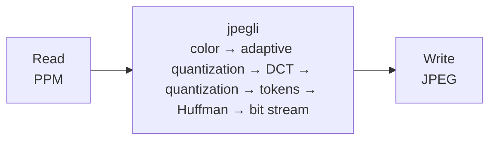
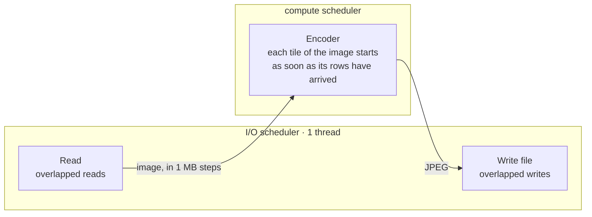
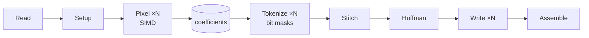
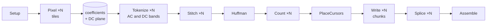
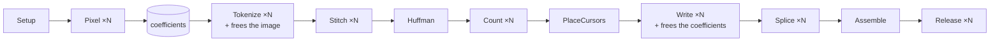
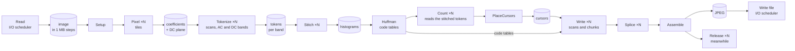

# How ctJpeg's task graph grew

ctJpeg did not start parallel. It started as a faithful port of jpegli's encoder and was taken apart
step by step, each step measured and checked byte for byte against jpegli. This page shows the task
graph after each step: what changed, why, and what it gave. The "In the code" paragraphs name the
classes and functions of today's code that implement each step; the README's
[Reading the code](../README.md#reading-the-code) gives an order to read them in.

[← back to the README](../README.md)

ctJpeg is not a stream of frames through a pipeline. It encodes one image as a **sequence of
stages**: each parallel stage hands a few hundred independent jobs to one worker task per thread,
and the next stage starts when all of them are done (fork-join). The edges are buffers in memory
that one stage fills and a later one reads.

**Four series of numbers.** All numbers are for one photo, 7216×5412 (39 megapixels), `-q 85`, on an
Intel Core i9-11900K (8 cores, 16 threads), as whole process time including reading and writing the
files. Only numbers within one series compare:

| Series | Steps | How it was measured |
|---|---|---|
| **development** | 0, 2 to 5 | single measurements during development, mostly AVX2 and 16 threads, jpegli measured alongside |
| **I/O test** | 1 | A/B test of today's encoder, memory-mapped against asynchronous reading and writing, alternating, warm 11 and cold 7 rounds, AVX2; cold means a fresh copy of the file, written unbuffered before every run, so it is not in the file cache; median of the per-run ratios |
| **tuning** | 6 and 7 | benchmark script on a quiet machine, best of 3 or 5, and series of 9 runs |
| **benchmark package** | 8 | the benchmark package of this repository, images read cold (not from the file cache), median of 5, High Performance power plan, 2026-10-17; the numbers of the README |

| Shape | Meaning |
|---|---|
| box | a stage that runs once, on the task that runs the graph (the main thread, converted to a task) |
| box ×N | a parallel stage: many jobs, one worker task per thread |
| cylinder | an edge: a buffer in memory |
| frame | a scheduler |
| arrow | data flow; a stage starts when the one before it is done |
| dotted loop | state carried from block to block or band to band |

---

## 0 · The reference: jpegli

One thread does everything in turn. jpegli is the JPEG encoder of the JPEG XL team: smaller files
than mozjpeg and libjpeg-turbo at the same visual quality, but on one core.

**Result (development series):** 0.78 to 0.88 s, depending on the run and the SIMD target.

These bytes are the yardstick: every later step writes exactly the same JPEG file, for each SIMD
feature set (SSE2 and AVX2) separately.

---

## 1 · Asynchronous reading and writing on an I/O scheduler

**Change:** as in our other encoders, a task of its own reads the file with several overlapped reads
in flight. Every 1 MB step of the file that has arrived wakes its waiters at once; a tile of the
pixel phase waits only for the step that holds its last rows and starts computing while the rest of
the file is still on its way. At the end a second task on the same I/O scheduler writes the JPEG
while the compute workers free the memory. (During development the input was first mapped into
memory, step 5; asynchronous I/O replaced it later. It is shown first here so that every product
starts with input and output.)

**Why (I/O test):** in practice a photo to be encoded usually is not in the file cache yet; it
comes from the disk. A mapped file then makes the encoder wait for many small page faults, while a
reader task fetches the file ahead with large reads.

| Photo | cold, 16 threads | cold, 4 threads | cold, one thread | warm, 16 threads | warm, 4 threads |
|---|---:|---:|---:|---:|---:|
| 39 megapixels (117 MB) | **0.72** | 0.75 | 0.92 | 1.23 | 0.96 |
| 11 megapixels | 0.90 | 0.67 | 0.92 | 1.14 | 0.99 |
| 3.4 megapixels | 0.99 | 0.83 | 0.94 | 1.01 | 1.03 |

- **Cold** (the file comes from an NVMe SSD): up to 33 % faster.
- **Warm** (the file is already in the file cache), all threads: 1 to 23 % slower. Windows then
  completes every read at once as a copy on the one I/O thread, and the pixel phase waits for that
  copy; a mapped file is read straight from the cache. With 4 threads or one there is no such cost.
- **Writing:** NTFS completes writes that extend a file synchronously, so the copy into the file
  cache runs on the I/O thread instead of in the background. As it happens while the memory is
  being freed, it costs the encoder nothing, and it saves 2 to 3 % on the large photo against
  writing at the end.

An instructive detour: real overlap only comes when each tile waits for its own rows alone, and
when the reader releases each step at once; a reader that reported only after its whole read
window (32 MB) left the pixel jobs waiting 10 ms.

**Result (I/O test):** reading and writing are tasks of their own on the I/O scheduler. With the
file coming from the disk the large photo is 28 % faster. All variants wrote the same bytes.

**In the code:** Read is `AsyncInput` (`src\Tasks\AsyncInput.h`), a `Task` that calls the library's
`AsyncFile::ReadFile` with itself as the `IWriteSequentialMemory` the data goes to: one buffer in
file order, and one `ManualResetEvent` per 1 MB step, set in file order as the reads complete
(`ReleaseWriteMemory`). A manual-reset event, because many tiles wait for the same step. Write file
is `AsyncOutput` (`AsyncOutput.h`), a `Task` that hands the finished JPEG to `AsyncFile::WriteFile`
as `IReadSequentialMemory`. `src\App\Application.cpp` sets up the one I/O scheduler (`Shared::TaskRuntime`), starts Read with
`StartRead` before the graph and parses the image header from the first step that has arrived
(`AsyncInput::ArrivedAfter`, `Image::ParsePnmView`); a header longer than that step waits for the
whole file. The tiles wait in `EncodeGraph::Pixel` (`AsyncInput::WaitFor`). `EncodeGraph::RunStages`
starts Write file right after Assemble and waits for it in a `TaskGroup_s` (one waiter: the task
that runs the graph).

---

## 2 · The port: the same graph, our own code

<picture>
  <source media="(prefers-color-scheme: dark)" srcset="images/step-2-state-dark.svg">
  
</picture>

Rendered with Mermaid's ELK layout, which draws the loops more cleanly than GitHub's built-in renderer; source: [images/step-2-state.mmd](images/step-2-state.mmd).

**Change:** jpegli's encoder, rewritten in C++ and split into phases: setup, the pixel phase
(color, adaptive quantization, DCT, quantization) and the entropy coding (tokens, Huffman tables, bit
stream). Between them lies the buffer of quantized coefficients.

**Why:** first a readable port that writes the same bytes, then parallelism. The loops show what
stands in the way: the tokens of a progressive scan carry runs of empty blocks from block to block,
and the bit stream carries its bit position. The pixel phase has no loop: it only looks a few pixels
around each block, so it already works in bands that compute their own border rows.

**Result (development series):** 1.25 s (SSE2) and 1.27 s (AVX2) against jpegli's 0.80 and 0.75 s,
about 1.6 times slower, but bit-identical in every test case. This graph is still in ctJpeg today:
`--sequential`.

**In the code:** the port is `src\Encoder\`, which has no task code. `EncodeJpeg` (`Encoder.cpp`) is
this graph as one function: `ComputeAllCoefficients` (setup with `SetupEncoder`, then the pixel
phase band by band with `ComputeCoefficients`) and `EncodeFromCoefficients` (`TokenizeScan` and
`AddScanHistograms` per scan, `OptimizeHuffmanCodes`, then `AssembleJpeg` with `WriteScanData` per
scan). `--sequential` runs it as the single task `SequentialEncodeTask` (`EncodeGraph::RunSequential`
in `src\Tasks\EncodeGraph.cpp`) on a compute scheduler of one thread, after Read has delivered the
whole file. Which jpegli function each part ports is listed in [porting.md](porting.md).

---

## 3 · The pixel phase goes parallel

**Change:** the bands of the pixel phase become jobs, about four per worker. Each worker takes the
next band from a shared counter; the encoder waits until all bands are done.

**Why:** the adaptive quantization only needs a small window around each block, so with a few rows of
context computed twice, every band is independent of the others.

**Result (development series, AVX2):** the pixel phase drops from 0.76 s on one thread to 0.12 s on
16, a factor of 6.4. The whole encode takes 0.70 s, 1.17 times as fast as jpegli. The serial entropy
coding (0.48 s) is now the limit.

**In the code:** every parallel stage is one call of `RunStage` (`src\Tasks\StageWorkers.h`) with a
lambda for one job; `EncodeGraph::Pixel` is the first. `RunStageJobs` (`StageWorkers.cpp`) is the
fork-join: it creates one `StageWorkerTask` per worker (at most one per job), adds them all to one
`TaskGroup_s`, hands them to the compute scheduler with `ITaskScheduler::AddTask` and waits with
`TaskGroup_s::Wait`. Each worker claims the next job index from an atomic counter until none is left.
The single-waiter `TaskGroup_s` fits, since only the calling task waits; a join of 16 workers costs
about 30 µs with it, as with `TaskGroup`. A job of
Pixel calls `ComputeCoefficients` (`src\Encoder\PixelPhase.h`) for its rows, with the
`PixelScratch` of its worker: the scratch memory belongs to the worker task, not to the thread,
because a tile that waits for its rows suspends its task, and another task may run on that thread
meanwhile.

---

## 4 · Tokens and the bit stream go parallel

<picture>
  <source media="(prefers-color-scheme: dark)" srcset="images/step-4-stitch-dark.svg">
  
</picture>

Rendered with Mermaid's ELK layout; source: [images/step-4-stitch.mmd](images/step-4-stitch.mmd).

**Change:** the entropy coding is taken apart on two levels.
- **Scans:** the scans of a progressive JPEG are independent of each other, one job each.
- **Bands:** the large scans are also cut into bands of block rows. Each band starts with a fresh
  state and reports compactly how it begins. A short **stitch** per scan then replays these
  beginnings with the real state: the runs of empty blocks across band borders, including jpegli's
  limits (a run ends after 32,767 blocks, a refinement run after 255 correction bits). The loop
  moved from every block to one step per band.
- **Writing:** in jpegli every scan ends on a byte boundary, so each scan is written into a buffer of
  its own, and a short serial step assembles them with their headers.

Only the Huffman tables stay serial: they need the symbol counts of all scans.

**Why:** after step 3 the entropy coding was the serial rest, the larger part of the work.

**Result (development series, AVX2):** 1.31 s on one thread, **0.31 s on 16**, 2.6 times as fast as
jpegli.

**In the code:** the nodes are `EncodeGraph::Tokenize`, `Stitch`, `Huffman`, `Write` and `Assemble`
(`src\Tasks\EncodeGraph.cpp`). The edge between Tokenize and Stitch is `TokenBands`
(`TokenBands.h`): `TokenBands::Plan` cuts the scans into jobs (whole scans, AC bands through all
AC scans of a component), and each band reports a `BandResult`. The band tokenizer and the stitch
are new in ctJpeg: `TokenizeScanBand` and `StitchScanBands` in `src\Encoder\BandStitch.cpp`; the
tokens of a scan are `ScanTokens`, whose parts in order are the scan's tokens (`Entropy.h`).
Huffman is serial and calls `OptimizeHuffmanCodes`; Assemble calls `AssembleJpeg`
(`src\Encoder\JpegFile.h`), the same function the sequential encoder uses.

---

## 5 · The same graph, less work per stage

**Change:** the graph stays; every stage gets faster. SIMD kernels for the pixel phase with exactly
jpegli's arithmetic (SSE2 with 4 lanes; AVX2 with 8 lanes and fused multiply-add), a tokenizer that
finds the non-zero coefficients of a block by bit masks, and buffers reused per worker.

**Why:** after step 4 ctJpeg was still slower than jpegli on one thread.

**Result (development series):** one thread 0.55 to 0.64 s, already 1.4 to 1.5 times as fast as
jpegli; 16 threads **0.24 s**. But the pixel phase now scaled only about 3 times.

**In the code:** the pixel phase is one source, `src\Encoder\PixelPhaseImpl.inc`, written against
`Vec<L>` (`VecMath.h`) and compiled once per feature set (`PixelPhaseSse2.cpp`,
`PixelPhaseAvx2.cpp`). Its scalar references and the self-test that compares every SIMD kernel with
them bit for bit are in `PixelPhaseReference.inc` (`LaneMath.h`); the unit tests run the self-test
(`src\Tests\KernelTests.cpp`). The bit masks are `ComputeMasks` in `Tokenize.cpp`.

---

## 6 · Smaller jobs that fit the cache

**Change:** a trace of every job showed, for every stage, which job finished it last. In a fork-join,
that job sets the time of the stage:

| Found | Changed | Gain |
|---|---|---|
| the DC scan ran as one job, and it ran last | DC scan in bands too, at least one per worker | tokens 69 → 56 ms |
| each large refinement scan was written by one worker | writing in chunks: **Count** counts the correction bits and run lengths each chunk reads, a short serial **PlaceCursors** turns the counts into the place where each chunk starts reading, **Write** writes plain bit streams, **Splice** joins them byte-exactly with JPEG's byte stuffing | writing 28 → 10–13 ms |
| a pixel job took 22 ms in parallel but 8 ms alone: the working sets of 16 workers overflowed the cache | pixel phase in tiles of about 1024 pixels width | pixel phase 89 → 38–46 ms |
| the DC bands touched every cache line of the coefficients | a dense plane of DC values, filled by the pixel phase | DC bands about 2 ms |
| the last AC bands decided when tokenizing ended | finer bands | tokens 39 → 33 ms |

**Why:** the work was spread well, but single jobs were too big or ran into memory.

**Result (tuning series):** **0.14 s** at 16 threads. The time now falls all the way to 16 threads;
before, the best was at 6 to 8.

An instructive detour: before the tiles, bands of a single block row were faster with 8 threads than
the default bands. It looked like load balancing; it was the cache. Only the same image at a quarter
of the width, where the pixel phase scaled 5.8 instead of 3.5 times, made it visible.

**In the code:** `EncodeGraph::Setup` chooses the tiles (bands of iMCU rows × strips of about
`DefaultStripWidth` = 1024 pixel columns); a Pixel job turns its index into band and strip. The DC
bands are `TokenizeDcBand` (`BandStitch.cpp`), the DC plane is part of `Coefficients`. The edge from
Count to Write, Splice and Assemble is `ScanChunks` (`src\Tasks\ScanChunks.h`): `ScanChunks::Plan`
plans the chunks, `EncodeGraph::Count` calls `CountRefinementStreams`, the serial
`ScanChunks::PlaceCursors` calls `LocateRefinementStreams`, `EncodeGraph::Write` calls
`WriteScanChunk` for a chunk and `WriteScanData` for a scan written whole, and `EncodeGraph::Splice`
calls `SpliceScanChunk` (all four new in ctJpeg, `src\Encoder\ChunkSplice.cpp`).

---

## 7 · The serial rest goes parallel

**Change:** a new parallel stage, **Release**, and extra jobs in two stages: the input image is
freed while the tokens are made, the coefficients while the scans are written.

**Why:** at 16 threads about 0.05 s lay outside the stages, most of it in giving hundreds of
megabytes back to Windows at the end. Leaving the memory to the end of the process does not help (we
measured: same total time, the cost only moves); spread over the workers, it shrinks.

**Result (tuning series, AVX2):** freeing 26 → 7–8 ms; whole encode 0.143 → **0.109 s**.

An instructive miss: freeing the coefficient buffer in parallel pieces was slower (11 → 14 ms); the
pieces of one memory region get in each other's way.

**In the code:** the extra jobs are side jobs of `RunStageWithSideJobs` (`StageWorkers.h`): they
come first in the stage's job list, so the workers claim them before the stage's real jobs.
`EncodeGraph::Tokenize` has one side job, `AsyncInput::Release` (it frees the input buffer after the
read has ended); `EncodeGraph::Write` has one per component, `Coefficients::ReleaseComponent`.
`EncodeGraph::Release` is an ordinary `RunStage` with one job per scan that frees its tokens, its
written data and its chunks.

---

## 8 · The complete graph

The stages run one after the other in this order; Count needs the tokens as Stitch left them, Write
needs the code tables of Huffman and the cursors of PlaceCursors. Write file and Release run at the
same time: the file is written on the I/O scheduler while the compute workers free the memory.

**Change:** the graph now stands in one place in the code, its nodes and edges in data flow order,
and `--sequential` is a graph of its own with a single task. The computing kernels did not change:
an A/B test against the previous build gave 0.96 to 1.04 of the time on three photos, with all
threads, few threads and one, both feature sets — measurement noise.

**Result (benchmark package, 2026-10-17, images read cold, AVX2, all outputs bit-identical to jpegli):**

| Machine | jpegli | ctJpeg | vs jpegli |
|---|---:|---:|---:|
| Intel Core i9-11900K (8 cores / 16 threads), the 39-megapixel photo | 0.821 s | 0.126 s | **6.5×** |
| Intel Core i9-11900K, 6 photos (99 megapixels) | 2.109 s | 0.425 s | 5.0× |
| Intel Xeon E3-1275 v6 (4 cores / 8 threads), 6 photos | 3.369 s | 0.672 s | 5.0× |
| Intel Core Ultra 7 155H (22 threads, hybrid), 6 photos | 2.673 s | 0.571 s | 4.7× |

**In the code:** `EncodeGraph` (`src\Tasks\EncodeGraph.h`) holds the graph: its header has it as a
diagram, the edges are members in data flow order, each with a comment naming the nodes it connects,
and the nodes are member functions in the same order. `EncodeGraph::Run` picks `RunStages` or
`RunSequential`; `RunStages` reads as the list of nodes: Setup, Pixel, Tokenize, Stitch, Huffman,
Count, PlaceCursors, Write, Splice, Assemble, then Write file and Release. Setup, Huffman,
PlaceCursors and Assemble run on the task that called `Run`, the main thread converted to a task
(`src\App\Application.cpp`). The unit test `src\Tests\GraphTests.cpp` checks the decomposition itself:
the graph with 1 to 7 workers and extreme splits (bands of one iMCU row, whole scans only, 9 bands
per AC scan, strips of 64 columns), with and without chroma subsampling, 14 variants, must write
exactly the file of the sequential `EncodeJpeg`.

[← back to the README](../README.md)
