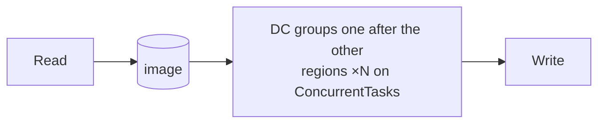
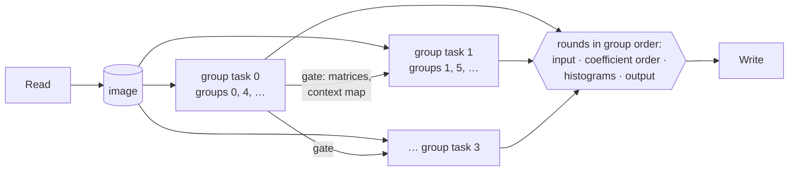
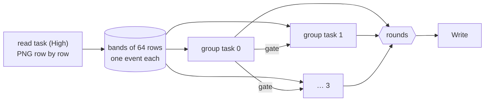
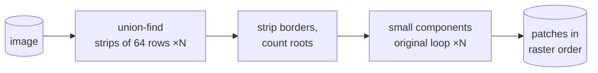
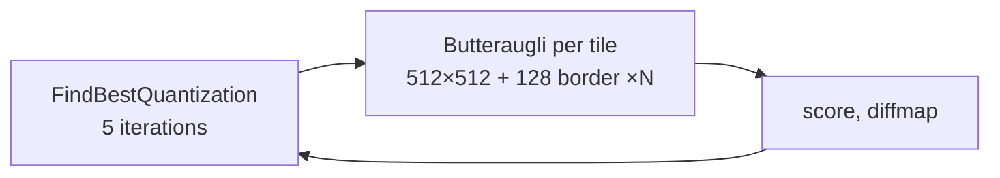
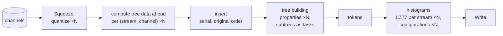
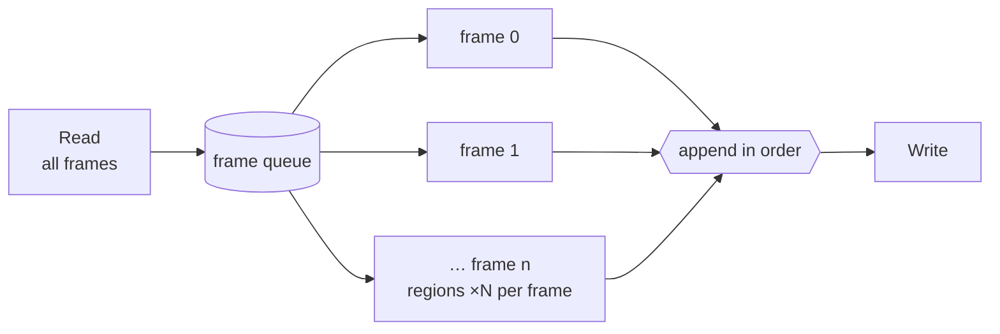
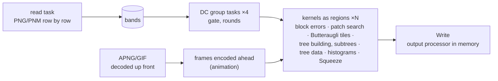

# How ctJxl's task graph grew

This page tells the development of ctJxl's task graph picture by picture, as of 2026-11-19. Each step has:

- **Graph:** nodes and edges, as a Mermaid diagram;
- **Change** against the previous step;
- **Why:** what was measured and why the step was needed;
- **Result:** measured, not estimated.

The code: the runner, `GroupSync` and `InputBands` in `src\Tasks\`, and the marked copies of libjxl files in
`src\Encoder\`; the README's [Reading the code](../README.md#reading-the-code) gives an order to read them in.

[← back to the README](../README.md)

ctJxl is built differently from ctLame and ctJpeg. The encoder is libjxl 0.13.0 itself: its kernels stay unchanged,
and they call `RunOnPool` (a fork-join over a range of indices) in about 50 places. ctJxl gives libjxl a runner on
ConcurrentTasks and replaces only the driver files that decide the flow (eleven files, every change marked
"ctJxl:"). So the graph grows in two layers: **regions** (fork-join inside a kernel, nested to any depth) and
**tasks with dependencies** above them (DC groups, the read task, frames). cjxl knows many paths through the encoder
(VarDCT, Modular, lossless, Fast Lossless, JPEG transcoding, animation); each path got its own measurement and its
own step.

**How it was measured.** All numbers: Intel Core i9-11900K (8 cores, 16 threads), wall time of the whole process
including reading and writing, against the reference cjxl (unmodified libjxl 0.13.0 built with MSVC, its own thread
pool with 16 threads). They are short measurements taken during development (mostly 5 runs without the best and the
worst, sometimes the median or the best of 3 or 5, file in the cache, ctJxl with the dynamic CRT, the reference with
the static CRT); the numbers of the benchmark package are measured separately. Numbers compare within one step,
between steps only roughly. Every file ctJxl writes is bit-identical to the reference cjxl (at first for each Highway
target, SSE2 and AVX2; ctJxl is now a pure AVX2 program). The factors in the steps were measured before
`/arch:AVX2`; with it VarDCT gains another 13–15 %.

**Legend:**

| Shape | Meaning |
|---|---|
| box | a serial node |
| box, stacked (×N) | a region: many items, one worker task per thread, the caller waits |
| hexagon | a gate or round: waits for another task |
| cylinder | an edge: a buffer in memory |
| arrow | data flow |

---

## 0 · The reference: cjxl with its thread pool

**Nodes:** reading, serial and up front; then the DC groups (2048×2048 pixels) strictly one after the other, each a
sequence of regions (color, heuristics, coefficients, reconstruction, tokens, encoding the groups); at the end,
writing.
**Edges:** the whole image in memory; the sections of the file.

**Why:** the starting point is cjxl 0.13.0 with its own thread pool. An instrumented clone shows for each path how
much stays serial between the regions (encoding time, 16 threads against serial):

| Path | serial | 16 threads | Speed-up | largest serial block |
|---|---|---|---|---|
| photo 6000×4000 `-q 90` (default) | 8.6 s | 1.87 s | 4.6× | gaps between the regions 32 % |
| photo lossless `-d 0` | 15.9 s | 2.22 s | 7.2× | gaps 5 % |
| photo `-q 50` | 13.0 s | 3.52 s | 3.7× | patch search 43 % |
| 2560×2304 `-q 90 -e 9` | 13.9 s | 10.3 s | 1.35× | Butteraugli iterations 86 % |
| 1024×768 lossless `-e 10` | 15.3 s | 15.7 s | 0.97× | one MA tree, 97 % |
| photo `-m 1 -q 80` | 11.9 s | 10.0 s | 1.2× | MA tree 52 %, histograms 21 % |
| JPEG transcoding | 0.69 s | 0.45 s | 1.5× | JPEG decoding, serial |

**Result:** cjxl's files are the yardstick for bit-identity. The table sets the order: first the default case, then
the large serial blocks.

---

## 1 · The runner: regions as tasks

**Nodes:** as in step 0. What is new is who runs the regions: a `JxlParallelRunner` on ConcurrentTasks. Each region
starts up to 16 worker tasks that take the items from a shared counter; the caller works along as worker 0 and then
waits in a `TaskGroup_s`.
**Change:** libjxl stays unchanged, only the runner is a different one. Because a caller only waits (its task is
suspended, the thread keeps working), regions may run inside regions – libjxl's own pool forbids that.

**Why:** only nested regions make the later steps possible: DC groups that run side by side as tasks and inside
compute their kernels in parallel again; subtrees that run as tasks and inside evaluate their nodes in parallel.

**Result:** on par with libjxl's pool (0–2 % difference), bit-identical in all test cases.

---

## 2 · DC groups as tasks

**Nodes:** four standing group tasks (R = 4), each with its own working state; task *s* encodes the groups *s*,
*s*+4, … in order. Inside them the kernels run as nested regions.
**Edges:** `GroupSync` – a **gate** (group 0 opens it as soon as the dequantization matrices, the block context map
and the qm scales are final; groups ≥ 1 wait in front of it and copy them) and four **rounds** in which the groups
take their turn in their order: input (the input callbacks are not meant for concurrent calls), coefficient order and
histograms (both chains: group *k* continues the state after *k*−1) and output (order in the file). One
`ManualResetEvent_s` per round and group.
**Change:** `enc_frame.cc` is the first replaced file. In the streaming path libjxl computes the groups with one
shared state; ctJxl gives each group its own and keeps only the chains in the frame state. Each group writes its
tokens with its own copy of the codes, so the histogram round covers only `EncodeGlobalACInfo`.

**Why:** in the default case 32 % of the encoding time lies between the regions: start-up and wind-down of each
region, small serial pieces. When several groups run at the same time, one group fills the gaps of the others.
Already a region before this step: the loop over the block errors in the AR heuristic (3–6 %).

**Result:** R = 2 → 1.22×, **R = 4 → 1.29×**, R = 6 → 1.19× (photo `-q 90`); lossless gains as well (1.10×),
because the streaming path is the same. The price: four working states, peak memory 987 MB instead of 476 MB (later
lowered to 710 MB, step 8). An attempt to move the gate forward and a limit on the inner workers per region gave
nothing and were taken out again.

---

## 3 · Reading and encoding overlap

**Nodes:** new is the **read task** with high priority: it decodes the PNG with libpng row by row.
**Edges:** `InputBands` – one `ManualResetEvent` per band of 64 rows; the input callback of a group waits for the band
of its last row. For PNM, libjxl itself reads row by row from a mapped file.
**Change:** libjxl copies the whole image up front, unless the encoder writes to an output processor; then each DC
group reads its part only while it is encoded. ctJxl always sets an output processor in memory and gives libjxl a
row-by-row input (PNM through libjxl's chunked decoder, PNG through a marked copy of `apng.cc`). Interlaced PNG, APNG
and chunks after the image data stay buffered.

**Why:** PNG decoding ran serially before encoding: 0.28 s, 11.5 % of the wall time for `sample-4.png`.

**Result:** `sample-4.png -q 90` 1.22× → **1.39×**; photo `-q 90` 1.31×.

---

## 4 · The patch search in strips

**Nodes:** the connected components in parallel in strips, one serial pass over the borders, then only the
components with at most 1,024 pixels through the unchanged loop body, in parallel.
**Change:** `enc_patch_dictionary.cc` as a copy. The patches enter the list in the same order as in the original's
loop.

**Why:** from distance 3 on (and without streaming) libjxl searches for text patches. On a photo almost the whole
image is a single component; the serial depth-first search walks all of it (1.4 s) and then discards it, because a
patch has at most 32×32 pixels.

**Result:** photo `-q 50` **1.60×**, photo `-q 90 --buffering 0` 1.61×, document 1024×768 1.19×.

---

## 5 · Butteraugli in tiles

**Nodes:** from effort 8 on (lossy, without streaming) libjxl compares the encoded image with Butteraugli in every
iteration. ctJxl computes each tile with its own, unchanged comparator on the tile plus a border of 128 pixels and
takes over the interior.
**Change:** `enc_adaptive_quantization.cc` as a copy (`TiledButteraugli`).

**Why:** the whole Butteraugli computation ran without the pool, 86 % of the encoding time at `-e 9`. All steps of
the diffmap are local (a reach of about 75 pixels through the lower scale); the only reduction is the maximum.

**Result:** 2560×2304 `-q 90 -e 9` **2.07×**, `-e 8` 1.90×. The price: peak memory 2.2 GB instead of 1.5 GB (the
borders overlap).

---

## 6 · Modular: trees, tree data, histograms

**Nodes:** five places in the Modular path (global MA tree: lossless `-e 10`, `-m 1`, Squeeze):
- **Tree building:** large nodes evaluate their properties in parallel; smaller nodes are set aside as **subtree
  tasks** (largest first), which inside evaluate in parallel again (nested regions). Afterwards the tree is numbered
  the way the serial depth-first search numbers it.
- **Tree data:** prediction, properties, quantization, tokens and hashes per (stream, channel) in parallel, in
  batches of 8 MB; a serial inserter inserts them in the original order (deduplication depends on the insertion
  order) and meanwhile already computes the next batch ahead.
- **Histograms:** LZ77 per stream, counting and evaluating the Uint configurations in sections in parallel;
  floating-point sums in the same order as serially.
- **Squeeze and quantization:** row by row.
- **Patch search** with the pool in the Modular path too (step 4).

**Change:** six more replaced files (`enc_ma`, `enc_encoding`, `enc_modular`, `enc_ans`, `enc_lz77`, `enc_squeeze`)
and overloads with a pool in four libjxl headers (marked, declarations only).

**Why:** the global MA tree ran with **one** task: 97 % at `-e 10`. Only splitting it into tree building, tree data
and histograms showed where the time lies (`-e 10`: tree building; `-m 1 -q 80`: tree data).

**Result** (each after the partial step):

| Step | 1024×768 `-d 0 -e 10` | 640×480 `-d 0 -e 9` | photo `-m 1 -q 80` |
|---|---|---|---|
| before (after steps 1–5) | 1.0× | 1.5× | 1.12× |
| properties in parallel | 2.45× | 1.67× | 1.14× |
| subtrees as tasks | 3.61× | 1.97× | 1.13× |
| computing tree data ahead | 4.20× | 2.22× | 1.44× |
| patch search, histograms | 4.40× | 2.4× | 2.0× |
| inserting finished samples | 4.68× | 2.77× | 2.37× |
| Squeeze, quantization | **4.5–4.7×** | **2.8–2.9×** | **3.2–3.5×** |

---

## 7 · Animation: encoding frames ahead

**Nodes:** once the input is closed (all frames queued), ctJxl encodes the frames at the front in parallel as items
of a region (at most 64 frames and 16 megapixels per window), each into a buffer of its own and with its own inner
regions.
**Edges:** the finished bytes per frame; when a frame reaches the head of the queue, the encoder appends them instead
of encoding it. Header, frame index and counters stay as in the original.
**Change:** `encode.cc` as the eleventh replaced file, three marked fields in `JxlEncoderQueuedFrame`.

**Why:** libjxl encodes the frames strictly one after the other; small frames have hardly any inner parallelism. GIF
640×360×30 `-d 0`: a load of 1.2 out of 16 threads.

**Result:** GIF 640×360×30 `-d 0` **6.5–7.3×**, `-q 90` **2.9–3.1×**; APNG 1280×720×30 `-d 0` 1.25×, `-q 90` 1.5×.
The price: peak memory for APNG `-d 0` 530 MB instead of 220 MB (with 4 megapixels per window 299 MB and somewhat
slower).

---

## 8 · The complete graph

What was not rebuilt, and why:
- **Lossless in DC groups (`-d 0`, default effort):** with the group tasks of step 2, 15 of 16 threads are already
  busy (7.9× against serial); the rest is hyper-threading.
- **JPEG transcoding:** the Huffman decoding of a JPEG without restart markers is serial; overlapping would need
  replacing the reader and `encode.cc` for 8–15 %. Stays at 1.0×.
- **Fast Lossless (`-e 1`):** already parallel; it reads the whole image up front (palette search), and overlapping
  changed the bytes.
- **Memory:** three buffers are freed earlier or not created at all (linear sRGB only without streaming, opsin after
  the coefficients, a mask after the AR heuristic): photo `-q 90` 855 → 710 MB.

**Checking the graph:** a test project (`src\Tests`, `GraphOrderTests`) runs every region on **one** scheduler
thread in other orders: worker tasks started backwards or shuffled, yielding after every item, every second item (or
random ones) at high priority, so that a later item overtakes the one before; the DC groups yield after every round,
the read task after every band. Every encode must write the file of the serial encoder. Counter-checks: without the
coefficient-order round or without waiting for a band the file differs, without the histogram round the test
crashes, without the output round the encoder fails.

**Result against the reference cjxl (short measurements):**

| Case | Factor |
|---|---|
| photo 6000×4000 `-q 90` (default) | 1.31× |
| `sample-4.png -q 90` | 1.4× |
| photo lossless `-d 0` | 1.15–1.2× |
| photo `-q 50` | 1.6× |
| 2560×2304 `-q 90 -e 9` | 1.9–2.0× |
| 1024×768 lossless `-e 10` | 4.4–4.7× |
| photo `-m 1 -q 80` | 3.2–3.5× |
| GIF 640×360×30 `-d 0` | 6.5–7.3× |
| JPEG transcoding, `-e 1` | 1.0× |

Room for improvement: EPF passes per group, tying the number of group tasks to cores and memory, an earlier gate for
machines with 32+ cores, the serial insertion of the tree data, overlap in JPEG transcoding, the decoding of
APNG/GIF.

[← back to the README](../README.md)
