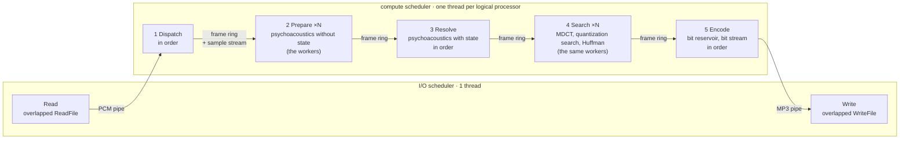

# ctLame: LAME, bit for bit, fourteen times faster

**ctLame** is an MP3 encoder that produces *exactly* the same files as LAME 4.0 (byte for byte)
and runs **14 times as fast** on an 8-core desktop CPU. It is a C++ port of LAME's VBR encoder,
built on **ThinkMeta.ConcurrentTasks**, a fiber-based task scheduler for Windows, and a first
look at the research project around it that runs from 2027 to 2029
([what comes next](#what-comes-next)).

ctLame was created **AI-assisted**, using ThinkMeta.ConcurrentTasks: AI coding agents wrote the
port, its parallelization and optimizations, measured and tuned the code under the direction of
ThinkMeta's developers, and every step was checked byte for byte against the reference. **An
in-depth code review is still pending:** the output is verified to be identical to the reference,
but the code itself has not yet been reviewed line by line.

**The source code of ctLame is here** (`src\`, GNU LGPL) and builds with Visual Studio 2026
([Building](#building)); `bin\` holds the prebuilt `ctLame.exe` the benchmark results below were
measured with.

| | lame.exe | ctLame |
|---|---:|---:|
| 45 hours of CD audio (343 files), `-V 4` | 19 min 55 s | **85 s** |
| speed | 136× real time | **1905× real time** |
| output | reference | **bit-identical** |

This repository contains:

| Folder | Contents |
|---|---|
| `bin\` | prebuilt Windows x64 binaries: `lame.exe` (the reduced LAME below), `ctLame.exe`, and `ThinkMeta.ConcurrentTasks.Core.dll` (the scheduler core ctLame runs on) |
| `src\` | the source of **ctLame**: `App` (the program, LAME's command line), `Tasks` (the task graph), `Encoder` (the port of LAME's encoder, without task code) and `Tests` (unit tests); the code all samples share (console output, version resource, CPU check, task setup, `--stats`) is in [`..\Shared`](../Shared/README.md); see [Reading the code](#reading-the-code) |
| `lame\` | the source of the **reduced LAME 4.0**, the reference ctLame is measured against |
| `ctLame.slnx` | a Visual Studio solution that builds `ctLame.exe` and `lame.exe` ([Building](#building)) |
| `verify\` | scripts that check a ctLame build byte for byte against `lame.exe`, with computed test signals and their reference hashes |
| `benchmark\` | a script to compare both encoders on your own WAV files: speed and bit identity (needs `ctLame.exe` in `bin\`) |
| `ThinkMeta.SolutionFiles\` | build settings; they forward to the ThinkMeta.ConcurrentTasks submodule next to this folder |

## Try it

No installation and no runtime to install: the C runtime is linked statically; the binaries need
nothing but Windows (10 or 11, x64).

```
bin\lame   -V 2 input.wav lame.mp3
bin\ctLame -V 2 input.wav ctlame.mp3
fc /b lame.mp3 ctlame.mp3
```

`fc` reports no differences. The command lines are the same, too: ctLame accepts every option of
the reduced LAME and prints the same messages.

To measure on your own music, run `benchmark\run.cmd D:\Music` (any folder of WAV files). It encodes
every file with both programs, one process at a time, and writes a report with the times and the
bit-identity check of each file. Every run reads a fresh copy of the file that is not in the file
cache (`-Warm` reads the files where they are). For the run it switches to the High Performance
power plan and restores the previous one afterwards (`-KeepPowerPlan` leaves it alone).

## Building

You need **Visual Studio 2026** with the workload *Desktop development with C++* (it brings the
C++ modules support and the native unit test framework the tests use). ctLame is built on the
library in the submodule `ThinkMeta.ConcurrentTasks.API`, so clone with submodules. Clone to a short
path such as `C:\src`; deeply nested folders can exceed the 260-character limit of the build tools.

```
git clone --recurse-submodules https://github.com/ThinkMeta-com/ThinkMeta.ConcurrentTasks.Samples.git
cd ThinkMeta.ConcurrentTasks.Samples\ctLame
msbuild ctLame.slnx /p:Configuration=Release /p:Platform=x64
```

(or open `ctLame.slnx` in Visual Studio and build *Release | x64*). The solution builds the library
modules, the ctLame projects and the reduced LAME. Everything lands in `build\Release\bin\`:
`ctLame.exe` with `ThinkMeta.ConcurrentTasks.Core.dll` next to it, `lame.exe`, and the unit tests
(`ThinkMeta.ConcurrentTasks.Samples.ctLame.Tests.dll`, run them in the Test Explorer or with
`vstest.console`). The golden tests need the WAV files their checksums were recorded with and skip
without them (environment variables `CTLAME_TEST_CORPUS` and `CTLAME_TEST_SYNTH`); the
measurements run only with `CTLAME_BENCH_FILE` or `CTLAME_BENCH_EVENTS` set.

Your build is not byte-identical to the published binaries: those are built with the static C
runtime, without buffer security checks and with profile-guided optimization (PGO), which makes
ctLame about 4 % faster. None of that changes what it computes: **the MP3 files of every build must
be bit-identical to lame.exe's**, and `verify\` checks exactly that.

### Checking a build

`verify\` needs PowerShell 7 (`pwsh`), nothing else:

```
pwsh verify\Verify-Lame.ps1 -Signals
pwsh verify\Verify-Lame.ps1 -WavDir D:\Music -Matrix Quick
pwsh verify\Compare-LameCli.ps1
```

- `-Signals` generates 20 test signals (`New-TestSignals.ps1`: tones, sweeps, noise, transients,
  every supported sample rate and sample format, edge cases) with integer arithmetic only, so they
  are the same bytes on every machine, encodes them with 780 combinations of options and compares
  every MP3 with `Reference-Hashes-Signals.csv`, the hashes the published `bin\lame.exe` writes
  (and unmodified LAME 4.0 as well, see [the reduced LAME](#the-reduced-lame)).
- `-WavDir` encodes WAV files of your own with your `lame.exe` and your `ctLame.exe` and compares
  the outputs. `-Matrix Smoke`, `Quick` or `Full` choose how many files and options;
  `-ExtraArgs '--threads 1'` or `'--sequential'` check the other execution paths, `-Repeat 3` output
  that depends on thread timing.
- `Compare-LameCli.ps1` runs both programs with 1012 command lines, including invalid ones, and
  compares exit codes, console output and the MP3 files.

Every check must end with all cases identical. The Verify scripts of all samples take the same parameters: `-Mode Compare` (default) or `Reference`, `-Matrix`, `-Exe` (the program to check, default: your Release build), `-Oracle` (the reference program), `-HashFile`, `-ExtraArgs` (options for `-Exe` only), `-Repeat n` (every case n times; all outputs must match), `-ThrottleLimit`, `-WorkDir` and `-TimeoutSec` (a run beyond it counts as a hang).

## Benchmarks

<details>
<summary><b>Machine and method</b></summary>

| | |
|---|---|
| CPU | Intel Core i9-11900K (Rocket Lake), 8 cores, 16 threads |
| System | Windows 11 Pro, power plan High Performance, no other load |
| Programs | the binaries in `bin\` |
| Settings | `-V 4` (LAME's default VBR quality), all other options at their defaults |
| Timing | wall time of the whole process (start, reading the WAV file, encoding, writing the MP3), one process at a time; every run reads a fresh copy of the WAV file that is not in the file cache (cold); per file the programs take turns, three rounds, the median of each file counts, the totals are the sums of the medians |
| Check | every MP3 of ctLame compared byte for byte with lame.exe's |
| Run | 17 October 2026 with `benchmark\run.cmd <folder> -Rounds 3`, the script in this repository |

</details>

### Corpus

343 WAV files ripped from CDs (44.1 kHz, 16 bit, stereo), 45 h 5 min of music in all: 313 single
tracks of 39 seconds to 9 minutes (21.7 hours) and 30 complete albums or discs saved as one file
each, 17 to 79 minutes long (23.4 hours): blues rock and classical crossover.

### Results

| Program | Time | Real-time factor | vs. lame.exe |
|---|---:|---:|---:|
| `lame.exe` (reference) | 1195.2 s | 136× | 1.00 |
| `ctLame` (all 16 threads) | 85.2 s | 1905× | **14.02** |

All 343 MP3 files of ctLame were bit-identical to lame.exe's.

On a single thread (`ctLame --sequential`, measured on 21 of the files, 3 h 9 min of music, one
round) ctLame took 50.5 s against 87.8 s for lame.exe, **1.74 times as fast**, thanks to
restructured loops and SIMD paths (SSE4.1, AVX2) that compute the same operations in the same
order as the scalar code, so they too give identical bits.

<details>
<summary><b>Per file</b>: short files gain less</summary>

| Files | Audio | lame.exe | ctLame | vs. lame.exe | per file: median (min to max) |
|---|---:|---:|---:|---:|---:|
| 313 single tracks | 21.7 h | 571.3 s | 43.4 s | 13.16 | 13.30 (5.25 to 15.94) |
| 30 albums in one file | 23.4 h | 623.9 s | 41.8 s | 14.92 | 14.86 (13.51 to 16.75) |

The shorter the file, the more the start of the process and the filling and draining of the
pipeline weigh: the lowest factor, 5.3, belongs to a 39-second intro, while every file of more than
16 minutes is encoded at least 13.5 times as fast.

</details>

### Other CPUs

The same 343 files, the same binaries and method (`benchmark\run.cmd <folder> -Rounds 3`):

| CPU | Cores / threads | lame.exe | ctLame | Real-time factor | vs. lame.exe |
|---|---|---:|---:|---:|---:|
| Intel Core i9-11900K (Rocket Lake, desktop) | 8 / 16 | 1195.2 s | 85.2 s | 1905× | **14.02** |
| Intel Xeon E3-1275 v6 (Kaby Lake, server, Windows Server 2016) | 4 / 8 | 1733.3 s | 217.1 s | 748× | **7.98** |
| Intel Core Ultra 7 155H (Meteor Lake, notebook) | 6 P + 8 E + 2 LP-E / 22 | 1531.8 s | 208.2 s | 780× | **7.36** |

<details>
<summary><b>Split by file length</b>: the notebook slows down under sustained load</summary>

| CPU | single tracks | albums in one file |
|---|---:|---:|
| Core i9-11900K | 13.16 | 14.92 |
| Xeon E3-1275 v6 | 7.95 | 8.02 |
| Core Ultra 7 155H | 9.51 | 5.79 |

On the notebook ctLame keeps up on the single tracks but loses half its speed on the albums,
which ran last; lame.exe, on one core, does not slow down there (see
[room for improvement](#room-for-improvement)).

</details>

Every encoding was bit-identical to LAME on every machine.

## Why this is hard

Parallelizing an MP3 encoder is easy if you may change its output: cut the audio into pieces and
encode them independently. ctLame may not. Its output has to be exactly LAME's, and LAME is
sequential by design:

- the **psychoacoustic model** carries state from frame to frame: attack detection, the switch
  between long and short blocks, pre-echo control, the adaptive hearing threshold;
- the **bit reservoir** lets a frame borrow bits that earlier frames left unused, so how a frame is
  coded depends on every frame before it;
- the **MDCT filterbank** needs the samples of the previous granule.

ctLame splits the work of each frame (1152 samples) into the parts that need this state and the
parts that do not. The stateless parts (FFTs, spreading, MDCT, the search for scalefactors and
quantization, Huffman coding) run for many frames at once on all cores; the stateful parts run as
thin links in frame order. Each frame passes five stages, numbered as in the code:



**[How the graph grew, step by step →](docs/task-graph.md)** from LAME's single loop to this graph,
with the reason and the measured gain of each step.

Prepare and Search are not two groups of tasks: the same N worker tasks, one per compute thread,
take whichever work is ready, searches first, since they belong to older frames and free slots
sooner. Dispatch converts the WAV data into the sample stream, one float stream per channel in
virtual memory; each frame in the ring points to its window there instead of copying it, and
Encode releases the window when the frame is done.

The frames in flight live in a ring of four slots per compute thread (16 to 128), the size that
measured best: fewer slots leave threads waiting for the ordered stages, more cost cache. Every
node is a task on ThinkMeta.ConcurrentTasks: when a node waits for the frame before it, its task
is suspended, and the thread runs other work meanwhile. Handing a frame from one thread to another
costs about 0.4 µs, against about 200 µs of work per frame.

Every change was checked against LAME's output: SHA-256 of 1372 encodings of 343 files and of
about 1000 encodings with other settings and input formats (mono, 32/48 kHz, 8/24/32 bit, float),
plus a comparison of 1012 command lines with all their console output.

## The reduced LAME

`lame\` is LAME 4.0 (release `RELEASE__4_0`, SVN r6552) reduced to what ctLame implements:
**MPEG-1 Layer III with the "new" VBR routine** (`-V`, `vbr_mtrh`) from **WAV files**.

| Kept | Removed |
|---|---|
| VBR new: `-V 0..9.999`, `-q`, the VBR presets | CBR, ABR, VBR old, free format |
| MPEG-1: 32, 44.1 and 48 kHz | MPEG-2/2.5, resampling |
| WAV input: PCM 8/16/24/32 bit, 32-bit float, also WAVE_FORMAT_EXTENSIBLE | AIFF, raw PCM, MP3 input, stdin and stdout |
| Xing/LAME VBR header | ID3v1/ID3v2 tags, ReplayGain, the frame analyzer |
| all options that tune VBR new: channel mode, bitrate limits, filters, ATH, noise shaping, short blocks, bit reservoir, scaling | the decoder, `--nogap`, the CPU/assembly dispatch (the SSE2 intrinsics path is always on) |

<details>
<summary><b>Size, output and build</b></summary>

The tree shrank from 319 to 68 files; libmp3lame from 26 301 to 16 782 lines, the frontend from
11 188 to 4 223 lines, `lame.h` from 1 357 to 800 lines, with no compiler warning left (57 before,
x64, warning level 4). The core of VBR new (`psymodel.c`, `vbrquantize.c`, `newmdct.c`, `fft.c`,
`tables.c`, `reservoir.c`) is nearly untouched.

**Output:** for the same options and a supported input file, the reduced `lame.exe` writes the same
bytes as unmodified LAME 4.0 run with `--noreplaygain`. The one exception: unmodified LAME lowers
the sample rate at `-V 6.5` and above (44.1/48 kHz) and at `-V 8` and above (32 kHz); the reduced
LAME always keeps the input rate, and is then identical to unmodified LAME with
`--resample <input rate>`. The default is `-V 4` instead of CBR 128 kbit/s.

`ctLame.slnx` builds it ([Building](#building)); the result is `build\Release\bin\lame.exe`, built
with the settings of `bin\lame.exe`. Each published
program has its fastest build: `ctLame.exe` is in addition profile-guided optimized (PGO) and
built without buffer security checks, which makes it about 4 % faster; for `lame.exe` both made it
slower (by 2.6 %), so it keeps the plain build.

</details>

## Command line

ctLame takes LAME's command line; `ctLame --help` and `ctLame --longhelp` list everything.

```
ctLame [options] <infile.wav> [outfile.mp3]
```

Options of ctLame only:

| Option | Meaning |
|---|---|
| `--threads n` | compute threads, 1 to 256; default: all logical processors |
| `--sequential` | the whole encoder as one task on one thread (the reference path) |
| `--simd level` | the highest SIMD level to use: `scalar`, `sse4.1` or `avx2`; default: the highest the CPU supports. All levels give the same bits |
| `--features` | print the CPU features and the SIMD level in use |
| `--stats` | print the time of each stage and the busy and idle time of each task after encoding (also: environment variable `CTLAME_PROFILE`) |

<details>
<summary><b>LAME's options</b>, all of which ctLame accepts</summary>

| Option | Meaning |
|---|---|
| `-V n` | VBR quality, 0 (best, largest) to 9.999 (smallest); default 4 |
| `-q n` | algorithm quality, 0 (best, slowest) to 9; default 3. `-h` = `-q 2`, `-f` = `-q 7` |
| `--preset type` | `medium`, `standard` or `extreme`: the same as `-V 4`, `-V 2`, `-V 0` |
| `-b n`, `-B n`, `-F` | minimum and maximum bitrate in kbit/s, enforce the minimum strictly |
| `-m mode` | `j` joint stereo (default), `s` simple stereo, `f` forced mid/side, `d` dual mono, `m` mono, `l` left, `r` right |
| `-a` | downmix stereo to mono |
| `--lowpass f`, `--highpass f`, `--lowpass-width f`, `--highpass-width f` | filters, in kHz |
| `--scale x`, `--scale-l x`, `--scale-r x`, `--gain dB`, `--swap-channel` | input scaling |
| `--ignorelength` | ignore the data length in the WAV header |
| `-Y`, `-Z [n]`, `--athaa-sensitivity x`, `--r3mix` | psychoacoustic tuning |
| `-t`, `-T` | do not write / force the LAME tag |
| `-p`, `-c`, `-o`, `-e emp` | CRC, copyright and original flags; emphasis `n`, `5` or `c` |
| `--nores`, `--strictly-enforce-ISO`, `--buffer-constraint c` | bit reservoir and stream constraints; `c` is `default`, `strict` or `maximum` |
| `--quiet`, `--silent`, `--brief`, `--verbose`, `-S` | console output |
| `--priority n` | process priority, 0 (idle) to 4 (high) |
| `--license`, `--version` | license and version |

</details>

## Reading the code

The parallel version adds a thin task layer (`src\Tasks\`) around an encoder that does not know
about tasks (`src\Encoder\`). Read it in this order:

1. **`src\App\Application.cpp`, `RunEncodeGraph`**: the setup of ThinkMeta.ConcurrentTasks, the same in
   every sample: `Shared::TaskRuntime` (`..\Shared\src\Shared\TaskRuntime.h`) makes the main thread a
   task with `ConvertThreadToTask`, because `EncodeGraph::Run` waits for the graph on it, starts the
   core's completion port for the overlapped file I/O (`EnableAsyncIo`) and an I/O scheduler with one
   thread for Read and Write. `EncodeGraph::Initialize` allocates the edges; a `RunningScheduler` is
   the compute scheduler with one thread per worker (`--threads`, else one per logical processor).
   The graph runs; on return the compute scheduler stops, the graph goes, and `TaskRuntime` undoes
   its steps in reverse order. The rest of `src\App\` is
   LAME's frontend: the command line (`CommandLine.cpp`), the WAV header (`WavFile`) and the
   messages.
2. **`src\Tasks\EncodeGraph.h`**: the graph as a diagram, then its members, the edges and the
   nodes in the order the data flows. `EncodeGraph::Run` (`EncodeGraph.cpp`) creates the nodes,
   puts all of them into one `TaskGroup_s` (one waiter: the caller), hands them to the schedulers
   with `ITaskScheduler::AddTask` (Read and Write to the I/O scheduler; Encode and Resolve first and
   with `High` priority, then Dispatch and the workers to the compute scheduler) and waits for the
   group. The graph owns its edges and their events and destroys the nodes before the edges.
3. **The edges**: `BlockPipe` (Read → Dispatch, the PCM pipe; Encode → Write, the MP3 pipe),
   `PcmFeed` (WAV bytes into the sample stream), `SampleStream` (`src\Encoder\`: one float stream
   per channel in reserved virtual memory, committed as it grows and decommitted behind the
   finished frames) and `FrameRing` (the frames in flight through the five stages). Their methods
   follow one vocabulary: `Acquire…` may wait and hands out the next piece of work, `TryAcquire…`
   does not wait, `Complete…` or `Commit…` hands the result on, `Release…` gives a block or a frame
   back.
4. **The nodes** (`src\Tasks\`), each a plain loop that waits on an edge: `WavReaderTask` (Read),
   `DispatchTask`, `WorkerTask` (Prepare and Search), `ResolveTask`, `EncodeTask` with
   `FrameEncoder` (Encode) and `Mp3WriterTask` (Write). `SequentialEncodeTask` is the one compute
   node of `--sequential`, with the same edges and the same encoder. `ProfiledRun` and `WhileIdle`
   (`NodeProfile.h`) only measure the nodes with `--stats` (or the environment variable `CTLAME_PROFILE`);
   read past them.
5. **The encoder** (`src\Encoder\`): `Encoder.h` has the four calls a frame goes through, one for
   each of the stages 2 to 5. `Prepare` and `Search` are `const`, so the compiler checks that they
   keep no state and may run for many frames at once; `Resolve` and `Encode` take the frames in
   order. `Stages.h` splits the stages further (2a to 5b), `FrameData.h` holds what belongs to one
   frame, the `…StageState` structures what a stage carries from frame to frame. The other files
   are the port of LAME; [docs/porting.md](docs/porting.md) maps LAME's functions to them.

The five stages of a frame, with the same numbers in `FrameRing.h`, `Stages.h`, `Encoder.h` and
[the history of the graph](docs/task-graph.md):

| Stage | Frames | Node | Encoder call | Work (`Stages.h`) |
|---|---|---|---|---|
| 1 Dispatch | in order | `DispatchTask` | | the frame's window of the sample stream |
| 2 Prepare | any order, N workers | `WorkerTask` | `Encoder::Prepare` | 2a input, 2b psychoacoustic model without state, 2c polyphase filterbank |
| 3 Resolve | in order, `High` | `ResolveTask` | `Encoder::Resolve` | 3a psychoacoustic model with state, 3b filterbank carry |
| 4 Search | any order, N workers | `WorkerTask` | `Encoder::Search` | 4a MDCT, 4b stereo decision, 4c quantization search and main data |
| 5 Encode | in order, `High` | `EncodeTask`, `FrameEncoder` | `Encoder::Encode` | 5a quantization with the bit reservoir, 5b bit stream |

"Encode" alone always means stage 5; `EncodeGraph` is the whole graph, and
`Encoder::RunAllStages` runs the four calls on one frame after the other (for the unit tests).

Why the frame ring is a class of its own and not the library's `Semaphore_s`: the stages need
more than a count (which frame, which kind of work, searches before preparations), and a counter
per stage plus an event costs one atomic operation per frame and stage. Three of its events have
exactly one waiter (Dispatch, Resolve and Encode) and use the cheaper `AutoResetEvent_s`; the
workers share one `AutoResetEvent`. `FrameRing.h` describes the protocol, and
`src\Tests\FrameRingTests.cpp` runs the ring under load with stand-in stages on a real scheduler.
`BlockPipe`, unlike the library's `SpscVirtualMemoryPipe`, holds back the producer when all blocks
are full, and its fill level sets the priority of the I/O tasks (`IoPriority.h`).

### Error handling

ctLame reports errors with LAME's messages and exit codes and does not try to recover:

- **A read error while encoding** ends the input there, like the end of the file: the frames read
  so far are encoded, the encoder is flushed and the LAME tag is written. ctLame prints "Error
  reading input file" and, like LAME, exits with 0.
- **A write error** ends the writing, but Write keeps taking the blocks from the MP3 pipe, so
  Encode never waits on a full pipe and the graph ends normally; then "Error writing mp3 output"
  and exit code 1. A LAME tag that is written only in part counts as a write error.
- **An error of the encoder** (LAME's "INTERNAL ERROR IN VBR NEW CODE", a frame too large for its
  buffer): Encode stops encoding but keeps taking the frames from the ring, so the stages before it
  finish; the message and the exit code are LAME's.
- **Out of memory:** `EncodeGraph::Initialize` checks the allocations of the edges and the workers
  before the graph starts ("ctLame: out of memory", exit code 1), and a scheduler or the
  asynchronous I/O that cannot be created ends the program with "ctLame: cannot start the
  schedulers" (exit code 1). If the sample stream (or the one frame of `--sequential`) gets no
  memory while encoding, the input ends there and ctLame reports `mp3 internal error:  error
  code=-3` (exit code 1). Allocations outside these checks, such as the encoder itself at the
  start, end the process when they fail; the sample does not unwind its graph for that case.

## Room for improvement

ctLame is fast, but not at the end; the measurements point to these limits and next steps:

* **Notebooks under sustained load:** on the Core Ultra 7 155H ctLame reaches 9.5× on the single
  tracks, but only 5.8× on the album-length files, which ran last, after about 35 minutes of full
  load. lame.exe on one core does not slow down on them (121× against 94× real time on the single
  tracks), so this is probably the notebook's sustained power or thermal limit, which cuts the
  clock of all cores when all of them are busy. A desktop CPU (14.9× on the albums) and the server
  CPU (8.0×) show no such drop. Whether fewer threads give more there is still to be measured.
* **Hybrid CPUs:** apart from that, performance and efficiency cores share the work well: on the
  155H all 22 threads are within 2 % of the best thread count. AVX2 brings nothing over SSE4.1
  there, probably because the efficiency cores execute 256-bit instructions in two halves. A
  scheduler that knows the core types is part of the research project.
* **The serial links:** at 16 threads ctLame finishes a frame every 13 µs. The in-order part of the
  psychoacoustics (stage 3, Resolve: attack detection, block switching, pre-echo control) needed
  about as much per frame before its pre-echo control was vectorized, so on this CPU it runs close
  to its limit. A split of Resolve into two short serial parts (about 5 µs per frame together) with
  a parallel part between them was tried and was bit-identical, but gave nothing on 8 cores, where
  the workers are fully busy; it is not in this code and waits for CPUs with more cores. The bit
  stream at the end (stage 5, Encode) takes about 4 µs per frame, since the Huffman coding moved
  into the parallel search.
* **Turbo clock and hyperthreading:** the same work costs more time the more threads run: about
  16 % more with 4 threads, 25 % with 8 (lower turbo clock, shared cache) and 50 % with 16, when
  two threads share a core. That is why 16 threads on 8 cores are 8 times as fast as one thread,
  not 16 times. With four cores (Xeon E3) ctLame reaches 8.0×, evenly for short and long files;
  there speed comes only from less work per frame.
* **Short files:** a 39-second file is encoded only 5 times as fast; starting the process and
  filling and draining the pipeline take a larger share there.
* **Less work per frame:** most of the time goes into the search for scalefactors and
  quantization, the psychoacoustic preparation and the MDCT. Long sums stay scalar because their
  order is fixed by bit identity. Tried and dropped: AVX2 gather (half as fast as scalar loads on
  Rocket Lake), AVX-512 lookup tables (would cover only 3 to 7 % more blocks) and a mode without
  bit identity (fused multiply-add): 2 % faster on one thread, nothing on 16.

Every step keeps the output bit-identical to LAME.

## ThinkMeta.ConcurrentTasks

ctLame is a showcase for **ThinkMeta.ConcurrentTasks**, a task scheduler for Windows by
ThinkMeta Software GmbH. Tasks run on fibers: a task can wait for a frame, an event or an
asynchronous file read without blocking its thread. A handful of threads keeps every core busy
while thousands of tasks wait, and code that waits stays as simple as sequential code.

- **Small and fast core:** the scheduler is a 25 KB DLL that depends on nothing but Windows
  (no C runtime). A task switch is a fiber switch; handing work to another thread costs well under
  a microsecond.
- **Building blocks on top:** tasks with priorities, events, semaphores and other synchronization
  primitives for tasks, concurrent collections, pipes in virtual memory, asynchronous file and
  socket I/O over completion ports.
- **Deterministic where it matters:** ctLame shows that a pipeline with ordered and parallel
  stages can keep a strictly sequential result while using every core.

The library itself (headers, modules, core DLL and its documentation) is in
[ThinkMeta.ConcurrentTasks.API](https://github.com/ThinkMeta-com/ThinkMeta.ConcurrentTasks.API),
included in this repository as the submodule
[`ThinkMeta.ConcurrentTasks.API\`](../ThinkMeta.ConcurrentTasks.API).

### Why fibers here

ctLame's ordered stages wait in the middle of their work: the dispatcher for a free slot in the ring
of frames, resolve for the psychoacoustic state of the frame before, the bit reservoir for the bits
that frame left over. On ConcurrentTasks such a wait suspends only the task, its thread meanwhile
runs the parallel search of other frames, and each stage stays a plain loop over the frames in
order. With a thread pool every one of these waits would either block a worker or have to be cut
into callbacks that save their state and are queued again once the frame before is done, with a
new frame about every 13 µs at 16 threads.

### What comes next

ctLame is a first look at ThinkMeta.ConcurrentTasks.
From January 2027 to December 2029 the framework is being developed further in a research and
development project that Germany's Bescheinigungsstelle Forschungszulage (BSFZ) has certified
as research and development under the research allowance (Forschungszulage). Today it runs on
Windows on x64; the project takes it further:

| Where | What |
|---|---|
| **Operating systems** | Linux and macOS besides Windows |
| **Desktop and server CPUs** | hybrid x64 processors with performance and efficiency cores (Intel Alder, Raptor and Arrow Lake, AMD Zen 4 and 5) |
| **Game consoles** | Xbox (GDK), PlayStation 5 and Nintendo Switch, on top of their own fiber APIs |
| **Embedded CPUs and MCUs** | ARM Cortex-A, -M and -R, RISC-V, Xtensa (ESP32) and PowerPC (automotive), on bare metal and next to RTOSes such as FreeRTOS and Zephyr |

The same task model on every platform: code that waits stays as simple as sequential code, and
fine-grained work (steps of a few microseconds, as in ctLame) is spread over every core.
ctOpus, ctDeflate and ctJpeg in the same repository apply it to further reference encoders.

Building a game engine, an industrial controller or another product that needs every core?
Want to run your own benchmarks or work with us? [www.thinkmeta.com](https://www.thinkmeta.com)

## License

- `lame\` and `bin\lame.exe`: LAME, GNU Library General Public License version 2 or later
  ([`COPYING`](COPYING)). Copyright (c) 1999-2011 The LAME Project and the authors named in the
  sources.
- `src\` and `bin\ctLame.exe`: a port of LAME, therefore also under the GNU LGPL version 2 or later
  ([`COPYING`](COPYING), [`src\ctLame-LICENSE.md`](src/ctLame-LICENSE.md)). Copyright (c) 2026
  ThinkMeta Software GmbH for the port, LAME's copyrights for the original.
- `bin\ThinkMeta.ConcurrentTasks.Core.dll`: proprietary, Copyright (c) 2026 ThinkMeta Software GmbH;
  terms of use in [`LICENSE-Core.txt`](LICENSE-Core.txt). ctLame.exe loads it at run time. The
  terms cover the DLL only: they permit its private and non-commercial use, commercial use of the
  DLL requires a license from ThinkMeta Software GmbH; they do not limit the rights the LGPL grants
  for ctLame.exe.
- `benchmark\`, `verify\`, `ThinkMeta.SolutionFiles\` and the build files: MIT license
  ([`LICENSE.txt`](LICENSE.txt)), Copyright (c) 2026 ThinkMeta Software GmbH (`.clang-format`
  there is a copy from the submodule).

**Benchmarks are explicitly permitted:** anyone may run benchmark tests of any kind with the
programs in `bin\`, on any hardware and for any purpose, commercial evaluation included, and publish
the results, including comparisons with other software, without asking ThinkMeta Software GmbH
first (point 2 of [`LICENSE-Core.txt`](LICENSE-Core.txt)).
