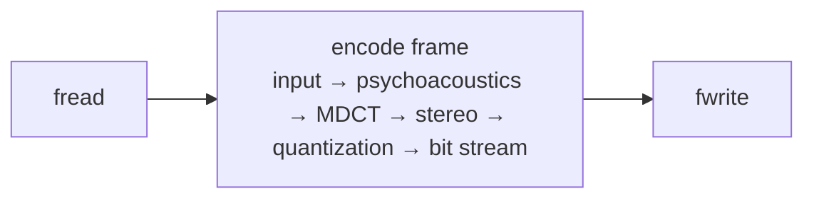
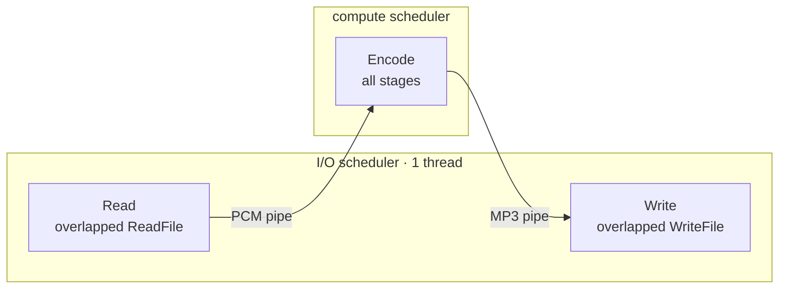
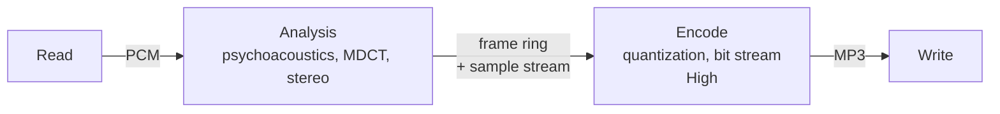
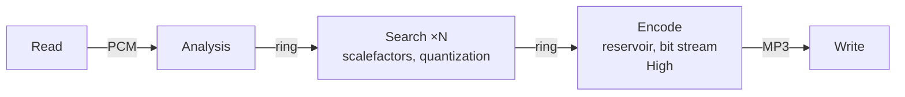
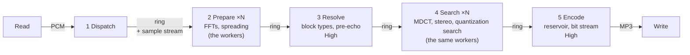
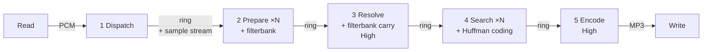
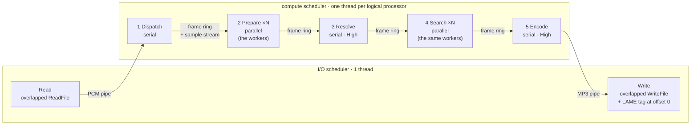

# How ctLame's task graph grew

ctLame did not start parallel. It started as a faithful copy of LAME's loop and was taken apart step
by step, each step measured and checked byte for byte against LAME. This page shows the task graph
after each step: what changed, why, what it gave, and where it is in the code.

[← back to the README](../README.md)

**Steps and stages.** The steps 0 to 8 on this page are the history. The stages a frame passes in
the finished graph are numbered 1 to 5, the same as in the code (`FrameRing.h`, `Stages.h`,
`Encoder.h`): **1 Dispatch, 2 Prepare, 3 Resolve, 4 Search, 5 Encode**. The diagrams from step 5 on
carry these numbers; [Reading the code](../README.md#reading-the-code) has them as a table.

**Two series of numbers.** Steps 2 to 5 were measured during development on one test file
(254 seconds of music, 9744 frames, `-V 4`, Intel Core i9-11900K with 16 threads), as the time of the
encoding pipeline. From step 5 on, the factor against `lame.exe` comes from benchmarks over a whole
corpus, as the time of the whole process. Only numbers within one series compare.

| Shape | Meaning |
|---|---|
| box | a task |
| box ×N | one task per compute thread; Prepare ×N and Search ×N are the same N worker tasks |
| frame | a scheduler: the I/O scheduler or the compute scheduler |
| arrow | an edge: a pipe of bytes, the sample stream or the ring of frames |
| dotted loop | a stage that carries state from frame to frame |
| **High** | a serial task that takes the frames in order, with high priority |

---

## 0 · The reference: LAME

One thread does everything in turn: read, encode, write. Every stage carries state from frame to
frame (the psychoacoustic model, the filterbank, the bit reservoir), so a frame cannot start before
the one before it is done. One core works, the others wait.

These bytes are the yardstick: every later step writes exactly the same MP3 file.

In the code: `lame_encoder_loop` (`lame\frontend\lame_main.c`) reads, encodes and writes in turn;
each frame goes through `lame_encode_mp3_frame` (`lame\libmp3lame\encoder.c`). ctLame's
counterparts are named in [porting.md](porting.md).

---

## 1 · One encoder task between asynchronous reading and writing

**Change:** reading and writing become tasks with overlapped I/O on an I/O scheduler of their own
(one thread for both); the whole encoder is one task on the compute scheduler.

**Why:** reading and writing now happen *while* the encoder works, not between its frames. The pipes
are bounded; their fill levels raise and lower the priority of the I/O tasks, so the encoder never
waits for data and memory stays small. The LAME tag at the start of the file is only known after the
last frame, so Write puts it there at the end. The I/O chain manages about 600 MB/s, far more than
the encoder will ever need.

**Result:** about as fast as LAME, bit-identical. This graph is still in ctLame today: `--sequential`.

Later, measured cold (a fresh copy of the WAV file that is not in the file cache, NVMe): what counts
is the amount of data in flight. Reads of 256 KB with five in flight were among the fastest shapes,
3 to 4 % faster than the first setting of 64 KB with four in flight; beyond about 1 MB in flight
nothing changed. The conversion into samples takes each block in pieces of 64 KB, whatever the read
size, so the frames go out evenly.

In the code: `EncodeGraph` (`src\Tasks\EncodeGraph.h`) with `--sequential`: `WavReaderTask` (Read)
→ PCM pipe → `SequentialEncodeTask` → MP3 pipe → `Mp3WriterTask` (Write). Both pipes are
`BlockPipe`s of 16 blocks, 256 KB each for the PCM pipe (the read size, `EncodeGraph::Settings`)
and 64 KB for the MP3 pipe; the I/O tasks keep up to five reads and four writes in flight with
`WaitableAsyncFileIoRequest_s`. `FillLevelPolicy` (`IoPriority.h`) sets their priority: the reader
runs with `High` while its pipe is less than 25 % full and with `Normal` again from 50 %, the writer
the other way round. `FrameEncoder::Finish` hands the LAME tag to the writer
(`Mp3WriterTask::SetFinalHeader`).

---

## 2 · Untangling the state (the graph stays the same)

<picture>
  <source media="(prefers-color-scheme: dark)" srcset="images/step-2-state-dark.svg">
  
</picture>

Rendered with Mermaid's ELK layout, which draws the loops more cleanly than GitHub's built-in renderer; source: [images/step-2-state.mmd](images/step-2-state.mmd).

**Change:** everything that belongs to one frame moves into one frame record; everything carried from
frame to frame moves into the state of its stage (the loops).

**Why:** you can only run in parallel what you can take apart. Now it is visible which stage carries
which state. Only one dependency crosses both stages and frames: the bit reservoir, which the bit
stream of frame N leaves to the quantization of frame N+1.

**Result:** the same speed (about 2 s for the test file), bit-identical, and a map of where the time goes:
mostly the quantization and the psychoacoustic model.

In the code: the frame record is `FrameData` (`src\Encoder\FrameData.h`); the stage functions in
`Stages.h` take the configuration, the state of their stage and the frame, and the state structures
`PsyStageState`, `MdctStageState`, `QuantizeStageState` and `BitstreamStageState` are the loops of
the picture. The six stages of the picture are today's sub-stages: input 2a, psychoacoustics 2b and
3a, MDCT 2c, 3b and 4a, stereo 4b, quantization 4c and 5a, bit stream 5b. The bit reservoir belongs
to `QuantizeStageState`: `BitstreamStage` of frame N sets the `main_data_begin` that
`QuantizeStage` of frame N+1 drains.

---

## 3 · Two tasks and a ring of frames

**Change:** the encoder is cut in two between analysis and quantization; a ring of frames connects
the halves. The input becomes one stream of samples per channel in virtual memory, and each frame
points into it instead of copying.

**Why:** both halves take about the same time. As a pipeline they overlap: frame N is quantized while
frame N+1 is analyzed. The later stage runs with high priority, so the pipeline drains before the
analysis runs further ahead. Handing a frame to another thread costs about 0.4 µs against about
200 µs of work per frame, so every frame is handed over on its own.

**Result:** 2122 → 1266 ms (1.68×). Now Encode is the bottleneck.

In the code: the ring is `FrameRing` (`src\Tasks\FrameRing.h`), which today has five stages instead
of two; the sample stream is `SampleStream` (`src\Encoder\SampleStream.h`), filled by `PcmFeed` and
released frame by frame by Encode. `src\Tests\EventCostBenchmark.cpp` measures what a hand-over
between two tasks costs (it runs only with the environment variable `CTLAME_BENCH_EVENTS` set).

---

## 4 · The quantization search runs frame-parallel

**Change:** the quantization is split. The search for scalefactors and the quantization run for many
frames at once; only a small commit with the bit reservoir stays serial.

**Why:** about 95 % of the quantization does not depend on the reservoir at all, only on whether a
granule is silent. What really depends on the frame before (the bit budget, the check "does the frame
fit?", the choice of the bitrate) takes a few microseconds.

**Result:** 1266 → 1150 ms. The step also showed that the scheduler woke all sleeping threads for
every new task; waking just one gave 1050 ms. Now the analysis, serial with its state, is the
bottleneck.

In the code: LAME's `VBR_new_iteration_loop` became two functions in `src\Encoder\Quantize.cpp`:
`QuantSearch` (today stage 4c, with `VbrSearchFrame` in `VbrQuantize.cpp`) and `QuantCommit`
(stage 5a, with `VbrFitFrame` and the reservoir functions of `Reservoir.cpp`).

---

## 5 · The psychoacoustic model is split: the graph takes its shape

**Change:** the psychoacoustic model is split into a stateless part, *Prepare*, and a serial part,
*Resolve*; the MDCT becomes stateless. Prepare and Search are the same worker tasks, one per thread.

**Why:** about 90 % of the psychoacoustic model needs no state (the long FFTs, the spreading, the
energies for attack detection). Only the decisions run in order: attacks, block types, pre-echo
control against the frames before. The MDCT only seemed to carry state; it is a function of the
input, which the sample stream keeps. The workers take searches first: they belong to older frames
and free slots sooner. Serial are now only three short links: Dispatch, Resolve and Encode.

**Result:** 1050 → **290 ms**, about 8 times as fast as `lame.exe` on the test file.

In the code: the encoder has four calls, `Encoder::Prepare`, `Resolve`, `Search` and `Encode`
(`src\Encoder\Encoder.h`), for the stages 2 to 5; the nodes are `DispatchTask`, `WorkerTask` (for
both kinds of work), `ResolveTask` and `EncodeTask` (`src\Tasks\`). A worker takes its work with
`FrameRing::AcquireWork`, which hands out searches before preparations. LAME's
`L3psycho_anal_vbr` became `PsyPrepare` (`PsyPrepare.cpp`, stage 2b) and `PsyResolve`
(`PsyResolve.cpp`, stage 3a).

---

## 6 · The serial links get thin

**Change:** work moves between the nodes. The Huffman coding of each frame moves into the parallel
search, so the serial bit stream only joins the coded pieces. The filterbank runs once in Prepare, and
Resolve hands its state on in order.

**Why:** every microsecond a serial link needs per frame limits all cores together.

**Result:** the serial bit stream from 17 to 3.8 µs per frame; corpus 7.8× → 8.3× `lame.exe`.

Tried and dropped: splitting Resolve further (two short serial parts with a parallel part between
them) was bit-identical but gave nothing on 8 cores, because the workers are fully busy; it is not
in the code and waits for CPUs with more cores. Other priorities, look-ahead or a bigger ring stayed
within the noise.

In the code: the main data (scalefactors and Huffman codes) is coded ahead by `PrepareMainData`
(`src\Encoder\Bitstream.cpp`) at the end of stage 4c; `FormatBitstream` (stage 5b) appends these bits
while the frame's `mainDataValid` holds, which the quantization clears when it changes the
granules. The filterbank is `MdctPolyphaseFrame` (stage 2c), the carry `MdctCarry` (stage 3b) and
the MDCT `MdctFromPolyphase` (stage 4a), all in `Mdct.cpp`.

---

## 7 · The same graph, less work per node

**Change:** SIMD paths in the parallel nodes that compute the same operations in the same order as
the scalar code, so they give the same bits; the ring grows with the number of threads.

**Why:** the graph was close to the best this machine allows, so the remaining gains had to come from
less work per frame; with a fixed ring of 32 slots, 16 threads ran out of frames in flight.

**Result:** corpus 8.3× → 12.8× (SIMD) → 14.2× (ring). Even on one thread ctLame is now 1.7 times as
fast as LAME.

In the code: the SIMD level is chosen once (`ChooseSimdLevel`, `--simd`), and
`Encoder::Initialize` picks the kernels of that level (`FhtFor`, `AttackPrepFor`, `MaskChainsFor`,
`MaskingLongFor`, `QuantizeKernelsFor`, `MdctKernels::WindowSubbandFor`). Each kernel is written
once in a `.inc` file (`FhtSimd.inc`, `MdctSimd.inc`, `PsySimd.inc`, `QuantizeSimd.inc`) and
compiled per level (`…Sse41.cpp`, `…Avx2.cpp`); `src\Tests\SimdTests.cpp` compares each with the
scalar code. The ring size is `FrameRing::SlotsFor`: four slots per thread, 16 to 128.

---

## 8 · The complete graph

With 16 threads: 21 tasks (Read, Dispatch, 16 workers, Resolve, Encode, Write), and a frame
finished about every 13 µs. The serial tasks wait in the middle of their work (Dispatch for a free
slot, Resolve for the frame before, Encode for the bits it left over); on ConcurrentTasks such a wait
suspends only the task, and its thread meanwhile runs the search of other frames.

| Edge | Carries | Bounded by |
|---|---|---|
| PCM pipe | the bytes of the WAV data | 16 blocks of 256 KB |
| sample stream | one float stream per channel in reserved virtual memory | only the windows of the frames in flight are committed |
| frame ring | one `FrameData` per frame, through the five stages | 4 slots per compute thread, 16 to 128 |
| MP3 pipe | the MP3 bytes in frame order | 16 blocks of 64 KB |

**Result**, 343 files, 45 hours of music, whole process: **14.02×** `lame.exe` on the Core i9-11900K,
7.98× on a 4-core Xeon E3, 7.36× on a Core Ultra 7 155H notebook. Every file bit-identical to LAME.
Details in the [benchmarks](../README.md#benchmarks).

In the code: `EncodeGraph` (`src\Tasks\EncodeGraph.h`) owns the edges and the nodes and has this
graph as a diagram in its header; `EncodeGraph::Run` starts all nodes in one `TaskGroup_s` and waits
for them. The ring's events: Dispatch, Resolve and Encode each wait on an `AutoResetEvent_s` of their
own (one waiter), the workers share one `AutoResetEvent`; `FrameRing.h` explains why the ring does not
use the library's `Semaphore_s`, and `src\Tests\FrameRingTests.cpp` runs it under load. The README's
[Reading the code](../README.md#reading-the-code) gives an order to read the files in.

[← back to the README](../README.md)
