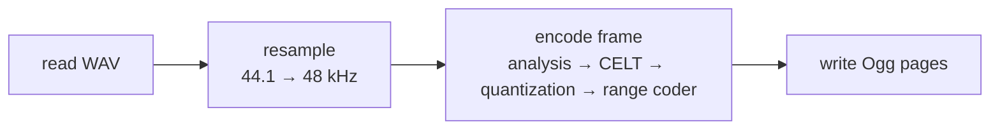
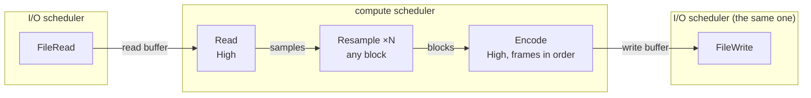
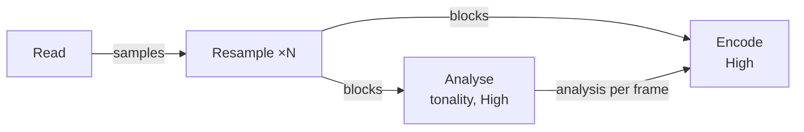
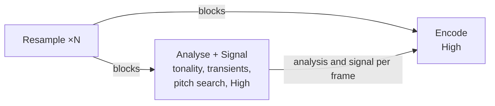

# How ctOpus's task graph grew

ctOpus did not start parallel. It started as a faithful copy of opusenc, ported function by function,
and was then taken apart step by step, each step measured and checked byte for byte against opusenc.
This page shows the task graph after each step: what changed, why, and what it gave. The paragraphs
"In the code" name the classes and files of each step (all under `src\`); the README's
[Reading the code](../README.md#reading-the-code) gives an order to read them in.

[← back to the README](../README.md)

**Four series of numbers.** All of them use the same test file (254 seconds of 44.1 kHz stereo music,
128 kbit/s) on an Intel Core i9-11900K with 16 threads, and measure the whole process (reading,
resampling, encoding, writing). Only numbers within one series compare:

| Series | Steps | How it was measured |
|---|---|---|
| **A** | 0, 2, 3 | median of 5 runs per variant, one variant after the other |
| **B** | 4 to 9 | all variants interleaved in one run; on some days the machine was 10 to 15 % slower, so opusenc always ran in the same run as the yardstick |
| **C** | 9 | the published benchmark: 343 music files, 45 hours, three PCs, cold, the binaries in `bin\` (2026-10-17) |
| **D** | 1 | the build before and after the step, alternating, 11 pairs, median of the ratios; opusenc in the same run |

| Shape | Meaning |
|---|---|
| box | a task; its name is the node's name in the code (`FileRead` is `FileReadTask`, `Read` is `ReadTask`, and so on) |
| box ×N | one task per compute thread, all doing the same kind of work |
| arrow | an edge: samples, blocks of resampled audio, the frames of the analysis chain, work handed over |
| arrow back to its own box | a stage that hands work to the next task of its kind (the speculation cascade) |
| dotted arrow | a way back: a correction, a seed or a cancellation |
| **High** | a serial task that takes the frames in order, with high priority |

---

## 0 · The reference: opusenc

One thread does everything in turn. Every frame continues where the frame before it left off: the
range coder, the energy prediction, the bit reservoir, the filter memories. A frame cannot start
before the one before it is done. One core works, the others wait.

These bytes are the yardstick: every later step writes exactly the same `.opus` file.

**Result (A):** `--comp 10` 2.16 s, `--comp 0` 0.97 s. ctOpus on one thread, the same encoder ported
to C++, is as fast: 2.09 s and 0.94 s.

**In the code:** the port is the static library in `Encoder\`, without any task code: libopusenc's
`ope_encoder_write_float` and `ope_encoder_drain` are `OggOpusEncoder::WriteFloat` and `Drain`, the WAV
reader of opus-tools is `WavInput`. [porting.md](porting.md) maps the functions of libopus, libopusenc
and opus-tools to their ports. opusenc's main loop is `SequentialEncodeTask::Run` (`Tasks\EncodeTasks.cpp`).

---

## 1 · Reading and writing asynchronously

<picture>
  <source media="(prefers-color-scheme: dark)" srcset="images/step-1-async-io-dark.svg">
  
</picture>

Rendered with Mermaid's ELK layout; source: [images/step-1-async-io.mmd](images/step-1-async-io.mmd).

**Change:** file input and output leave the encoder. FileRead and FileWrite are tasks of their own on
the I/O scheduler; the encoder is still one task that does everything opusenc does.

**Why:** opusenc's single thread waits for the disk on every read and writes every Ogg page with a
system call of its own, thousands of times for the test file. Now FileRead keeps five overlapped reads
of 1 MB in flight, and the operating system reports each completed one through an I/O completion port;
the encoder only takes finished blocks. FileRead and FileWrite use the library's helpers for reading and
writing a whole file asynchronously (`AsyncFile::ReadFile` / `WriteFile`). The encoder copies the Ogg
pages into a write buffer, and FileWrite writes full blocks of 64 KB with overlapped writes. While
FileRead or FileWrite wait for the disk they hold no thread: the I/O scheduler runs the other one.
Input from stdin and output to stdout stay synchronous.

**Result (D, cold: a fresh unbuffered copy of the input before every run, not in the file cache):**
bit-identical in all gates, through stdin and stdout too. With one encode task (`--comp 10`, 9
rounds): synchronous 1.891 s, asynchronous 1.876 s (−0.3 % median ratio, within the noise; opusenc `--comp 10` in
the same run 2.083 s); the encoder consumes its input at about 25 MB/s, far below what the disk
delivers. In the full graph of step 9: 16 threads 0.486 → 0.474 s (−2.0 %), 4 threads 0.780 →
0.760 s (−2.6 %), because there Encode wrote the Ogg pages on the critical path. Warm the picture was
the same. Block size and number of reads in flight do not matter for ctOpus (64 KB to 4 MB × 2 to 16,
growing blocks too: all within ±3 %).

**In the code:** `FileIo` (`Tasks\FileIo.h`) holds both sides: the nodes `FileReadTask` and
`FileWriteTask` around the library's `AsyncIo::AsyncFile::ReadFile` and `WriteFile`, and the two
buffers, each a `BlockPipe` (one producer, one consumer, on different schedulers). The encoder's side
sees only the stream interface of the ported frontend: `InputFile` reads through `InputSource`
(`Encoder\WavInput.h`), which `FileIo` implements, and the Ogg pages go out through the encoder's write
callback (`FileIo::Write`). This graph is still in ctOpus: `SequentialGraph` with its one node
`SequentialEncodeTask` (`Tasks\EncodeGraph.h`) runs for `--sequential`, and when the parallel graph
cannot allocate its edges.

---

## 2 · Resampling in parallel

**Change:** the resampler becomes a parallel stage. A new task, Read, unpacks the WAV samples and
hands out blocks of 16 384 output samples as soon as their input is there; any worker computes any
block; Encode takes them in order. Read only waits for tasks (blocks from the read buffer, free
slots in the ring) and computes, so it runs on the compute scheduler with high priority: every
resampler waits for its blocks. (The first build, still with synchronous reads, had it on the I/O
scheduler; the numbers of this step come from that build.) Measured (D, cold): Read on the compute instead of the I/O scheduler, 16 threads 0.474 → 0.466 s (−0.4 %), 4 threads 0.760 → 0.744 s (−2.0 %), bit-identical.

**Why:** resampling was the largest single cost of opusenc. Each output sample of its resampler is
one dot product whose filter phase follows from the sample's index alone, so blocks can be computed
independently and give the very same floats, summed in the order of the SSE code opusenc uses.

**Result (A):** `--comp 10` 1.86 s (1.16× opusenc), `--comp 0` 0.70 s (1.38×). The resampler has
left the critical path; what remains is the serial encoder.

**48 kHz input** needs no resampling; opusenc copies it into its buffer unchanged. It goes through the
same graph: the resampler becomes a filter of length 1, and Resample only copies the samples into the
interleaved blocks. Earlier versions encoded such input on one thread, with the graph of step 1;
going through this graph made it 3.6× faster.

**In the code:** the nodes `ReadTask` and `ResampleTask` (`Tasks\EncodeTasks.h`, `.cpp`); the edges
`PcmFeed` (the samples, in a `PlanarStore` that is committed as the input arrives and decommitted behind
the oldest block still in use) and `BlockRing` (the blocks), both in `Tasks\GraphEdges.h`. The ring has
two slots per compute thread and four more, at least 8 and at most 64 (`EncodeGraph.cpp`). Its methods
name the stage and the step (`AcquireRead`, `CompleteRead`, `AcquireResample`, `CompleteResample`,
`AcquireEncode`, …); `AcquireResample` hands the next dispatched block to whichever worker asks.
The computation is `ParallelResampler::Compute` (`Encoder\ParallelResampler.cpp`); at 48 kHz
`EncodeGraph::Initialize` calls `ParallelResampler::InitializeIdentity` instead of `Initialize`
(`PcmFeed::resampled` is then false). The slots are counted with counters and events, not with the
library's `Semaphore_s`: a slot is free only once all stages that read it have its block, and Read
needs the number of the released block, not a count. `EdgeTests.cpp` (`src\Tests\`) runs the ring
under load with stand-in nodes.

---

## 3 · An analysis chain runs ahead

**Change:** the tonality analysis of each frame moves to a task of its own, which reads the same
blocks and runs ahead of Encode.

**Why:** the analysis depends only on the audio and on the schedule of the frames, never on the
encoder's decisions. The chain replays exactly the sequence of calls opusenc makes, keeps a history,
so nothing Encode still reads is overwritten, and stays at most 200 frames ahead.

**Result (A):** `--comp 10` 1.73 → 1.52 s. Encode no longer waits for anything; what remains is
serial work.

**In the code:** the node `AnalyseTask` runs `ToneChain::RunAnalyse` (`Tasks\ToneChain.h`, `.cpp`).
`ToneChain` holds the rings of the chain, one entry per call of the encoder's write loop
(`OpusStreamEncoder::EncodeNative`), and implements the encoder's hook interface `ToneAnalysisSource`
(`Encoder\OpusStreamEncoder.h`), through which the encoder reads the results (`Wait`). A slot of the
block ring is free once Encode and Analyse have its block (`CompleteEncode`, `CompleteAnalyse`).

---

## 4 · The signal stage moves into the chain

**Change:** the chain also computes the part of the CELT encoder that depends only on the signal:
pre-emphasis, tone and transient detection, pitch search.

**Why:** Encode checks every frame of the chain against its own state byte for byte and only takes
it if it matches exactly. If the chain ever runs apart (a reset, a speech frame), Encode is slower,
never wrong. On the test file it took 12 725 of 12 725 frames.

**Result (B):** `--comp 10` 1.47 s against opusenc `--comp 10` 2.38 s in the same run (0.62 of its
time, before 0.74).

**In the code:** the signal stage is `CeltEncoder::SignalStage`, run by the chain through
`CeltEncoder::AnalyseSignal` into a `CeltSignalFrame` (`Encoder\CeltEncoder.h`); the chain rebuilds the
CELT input with `CeltInputChain`. Encode reads the frame through `ToneAnalysisSource::WaitSignal`.

---

## 5 · A speculative front part

<picture>
  <source media="(prefers-color-scheme: dark)" srcset="images/step-5-front-dark.svg">
  
</picture>

Rendered with Mermaid's ELK layout; source: [images/step-5-front.mmd](images/step-5-front.mmd).

**Change:** the chain goes further and computes the next frame's front part: pre-filter, MDCT, band
energies, normalisation, time-frequency and spreading decisions.

**Why:** these depend on only a few values of the serial encoder, and those rarely change. The chain
assumes them as they were at the last check. If Encode finds a mismatch, it sends its true state back
(the dotted arrow), and the chain computes again from there.

**Result (B):** 12 724 of 12 725 frames taken. `--comp 10` 1.21 s, then 1.00 s, against opusenc
`--comp 0` 0.97 s in the same run.

**In the code:** the front part is `CeltEncoder::Front`, which fills a `CeltFrontFrame`; Encode reads
it with `ToneAnalysisSource::WaitFront` and sends its true values back with `Resync`
(a `FrontSync`, `Encoder\OpusStreamEncoder.h`). A front frame counts only if it was computed after the
last resync (its epoch, `ToneChain.h`).

---

## 6 · Front on its own, and a helper for the rounding trial

<picture>
  <source media="(prefers-color-scheme: dark)" srcset="images/step-6-theta-dark.svg">
  
</picture>

Rendered with Mermaid's ELK layout; source: [images/step-6-theta.mmd](images/step-6-theta.mmd).

**Change:** the front part becomes a task of its own. A new task, Theta, takes over one of two
trials Encode makes for each stereo band.

**Why:** at complexity 8 and above the encoder quantizes every stereo band twice, with the stereo
angle rounded down and up, from the same state, and keeps the cheaper one. The two trials can run at
the same time. A trial takes only one or two microseconds, so both sides wait actively first and only
then sleep. The graph gets the Theta task only where it can help: at `--comp 8` and above (below, there
is no second trial) and from 3 threads (it spins and needs a thread to spare).

**Result (B):** `--comp 10` 0.80 s against opusenc `--comp 0` 0.99 s in the same run. **From here on,
ctOpus at maximum complexity is faster than opusenc at minimum complexity.**

**In the code:** the nodes `FrontTask` (`ToneChain::RunFronts`) and `ThetaTask`; the edge Encode ⇄
Theta is `ThetaHelper` (`Tasks\EncodeHelpers.h`), which implements the encoder's hook
`ThetaTrialRunner` (`Encoder\CeltBands.h`): `QuantAllBands` starts the second trial (`Start`), computes
the first and then waits for the second (`Finish`). Both sides spin first and then block on an
`AutoResetEvent_s`; the comment above the class explains why no wake-up is lost. The thresholds are
`ThetaHelperThreads` and `ThetaTrialComplexity` at the top of `Tasks\EncodeGraph.cpp`.

---

## 7 · Lighter work for Encode (the graph stays the same)

**Change:** more of what Encode did moves to the chain and to Front: the input stage of each stream
(DC filter, silence, frame energy, stereo width) and the stereo angles of the top level; work that
only served the trials is skipped after the last trial.

**Why:** everything Encode no longer computes shortens the serial chain. Every handover is still
checked for exact equality.

**Result (B):** `--comp 10` 0.70 s against opusenc `--comp 0` 1.02 s and `--comp 10` 2.11 s in the
same run.

**In the code:** the input stage of a stream is a `StreamInputFrame` (`Encoder\OpusStreamEncoder.h`),
computed by the Signal stage and read by Encode with `ToneAnalysisSource::WaitInput`.

---

## 8 · Speculating on the next frame

<picture>
  <source media="(prefers-color-scheme: dark)" srcset="images/step-8-speculate-dark.svg">
  
</picture>

Rendered with Mermaid's ELK layout; source: [images/step-8-speculate.mmd](images/step-8-speculate.mmd).

**Change:** while Encode quantizes frame N, a Speculate task already quantizes frame N+1 on a copy
of the encoder, with what frame N will leave behind guessed. The signal stage moves to a task of its
own, so the chain keeps up.

**Why:** the bands of a frame are coded one after the other, but from one frame to the next only two
small things pass: a few bits left over at the end of the frame, and the state of the range coder
(needed late, if at all). Speculate records every symbol it codes. If all its inputs turn out to be
right, Encode replays the record instead of computing the frame; if not, Speculate stops at the next
band. Encode and Speculate take turns.

**Result (B, on a busy day):** about 96 % of the speculated frames are taken. `--comp 10` 0.70 s
against 0.83 s without speculation in the same run, about 15 % faster. Below 7 threads there are more
busy tasks than threads, and the speculation costs more than it gains; the graph has it from 7 threads.

**In the code:** the nodes `SignalTask` (`ToneChain::RunSignals`) and `SpeculateTask`; the edge Encode →
Speculate is `SpeculationQueue` (`Tasks\EncodeHelpers.h`), which implements the encoder's hook
`SpeculationRunner`. The speculation itself is in `Encoder\CeltSpeculation.h` and `.cpp`:
`CeltEncoder::BuildSpeculation` clones the encoder and posts the run, `RunSpeculation` runs it on the
Speculate task (the next frame's encoding up to its quantization job, `RunQabJob`),
`CeltEncoder::TakeSpeculation` checks the job's inputs (`SameQabInputs`) and replays its `SymbolLog`
(`Encoder\RangeEncoder.h`). `CeltEncoder::SpeculateNext` and the next frame's inputs, which Encode looks
at ahead with `ToneAnalysisSource::PeekCall`, decide whether a speculation is built at all. The seed of the folding noise is a
`SeedPromise` (`Encoder\CeltBands.h`), the cancellation a flag the job checks at every band. The header
of `CeltSpeculation.h` describes the states of a speculation, who changes them and why the encoder's
short spins are safe. This protocol is ctOpus's own, outside the library; the tasks only carry it.

---

## 9 · Three frames ahead: today's graph

<picture>
  <source media="(prefers-color-scheme: dark)" srcset="images/graph-dark.svg">
  
</picture>

Rendered with Mermaid's ELK layout; source: [images/graph.mmd](images/graph.mmd).

**Change:** the speculation becomes a cascade of up to three levels: the copy for frame N+1 builds
the copy for frame N+2 at the same point, and so on (the arrow from Speculate back to itself). Each
level can have its own Theta helper.

**Why:** with enough threads the serial chain can work several frames ahead. Every additional busy
core also lowers the turbo clock of all cores, the serial one included, so each level only pays from
a certain number of threads. Measured, `--comp 10` (B):

| Threads | no speculation | one level | two levels |
|---:|---:|---:|---:|
| 5 | 0.71 s | 0.85 s | 0.96 s |
| 7 | 0.71 s | 0.56 s | 0.61 s |
| 8 | 0.71 s | 0.56 s | 0.53 s |
| 10 | 0.71 s | 0.56 s | 0.46 s |
| 16 | 0.71 s | 0.61 s | 0.53 s |

Three levels give 0.46 to 0.48 s from 8 threads on. Today's rule: no speculation below 7 threads,
one level at 7 (it gets its own Theta helper), three from 8, and Theta helpers for the three levels
from 12. All Theta helpers only at `--comp 8` and above.

**Result:**
- **One file (B):** opusenc `--comp 0` 0.99 s, opusenc `--comp 10` 2.21 s, **ctOpus `--comp 10`
  0.50 s, `--comp 0` 0.31 s.** At maximum complexity ctOpus is twice as fast as opusenc at minimum
  complexity.
- **The corpus (C, today's build, measured cold):** 343 music files, 45 hours, `--comp 10 --bitrate 128`, all files bit-identical:

| PC | opusenc | ctOpus | faster |
|---|---:|---:|---:|
| Intel Core i9-11900K, 8 cores / 16 threads | 1 279 s | 290 s | **4.4×** |
| Intel Xeon E3-1275 v6, 4 / 8 | 1 788 s | 438 s | **4.1×** |
| Intel Core Ultra 7 155H, 16 / 22 (notebook) | 1 431 s | 560 s | **2.6×** |

**In the code:** `EncodeGraph` (`Tasks\EncodeGraph.h`) has this graph as a diagram in its header.
`EncodeGraph::Run` (`EncodeGraph.cpp`) applies the rule above (`OneLevelThreads`, `CascadeThreads`,
`LevelHelperThreads`), links the levels (`CeltSpeculation::cascade`: each level's clone carries the
next level's speculation, and the next level's seed is the final range of this level's job), creates
the nodes, adds them all to one `TaskGroup`, starts them with `TaskPriority::High` (the resamplers with
`Normal`) and waits for the group. When Encode is done it stops the nodes that serve it (`EncodeTask`).
`GraphTests.cpp` (`src\Tests\`) checks the graph against `SequentialGraph` byte for byte with 1, 2, 3,
7, 8 and 12 threads, so with every combination of these nodes.

**Why fibers matter here:** about a dozen stages run at once, each a plain loop that waits on an edge
for its next frame or job: the resamplers, the three stages of the chain, Encode, up to three
Speculate levels and the Theta helpers. A wait suspends only the task, and its thread runs another
stage meanwhile, so the stages share one thread per logical processor.

[← back to the README](../README.md)
